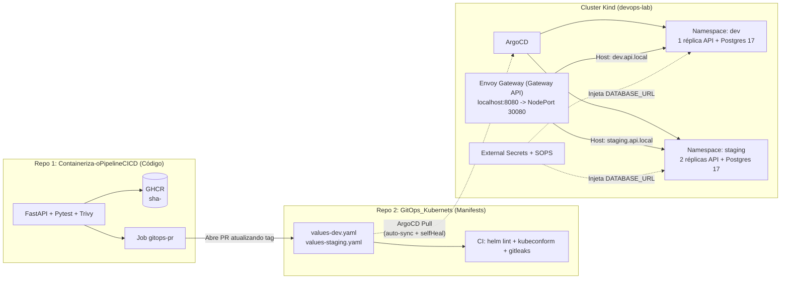

# Projeto 3 · GitOps em Kubernetes com ArgoCD, Gateway API e External Secrets

[](https://github.com/Gabriel-V-Mendes/GitOps_Kubernets/actions/workflows/ci.yml)

Repositório dedicado de **manifests Kubernetes e GitOps** para a [**API do Projeto 1 (`Containeriza-oPipelineCICD`)**](https://github.com/Gabriel-V-Mendes/Containeriza-oPipelineCICD) (FastAPI + PostgreSQL 17, imagem non-root `UID 10001`). O estado desejado dos ambientes **`dev`** e **`staging`** vive exclusivamente neste repositório e é reconciliado continuamente dentro de um cluster **`kind`** pelo **ArgoCD**.

---

## 1. O que mudou (Arquitetura Atualizada)

| Antes (Versão Antiga) | Depois (Esta Versão) | Por quê |
|---|---|---|
| Aplicação HTML estática (`nginx:alpine`) misturada no mesmo repositório | **Repositório separado de manifests** consumindo a imagem real da **API do Projeto 1** (`ghcr.io/gabriel-v-mendes/containeriza-opipelinecicd:sha-...`) | Isola o ciclo de vida de código (CI) do estado declarativo do cluster (CD/GitOps) e evita loops de trigger |
| **Ingress NGINX** (`networking.k8s.io/v1/Ingress`) + configs órfãs do Istio | Começa com **`kubectl port-forward`** e expõe via **Gateway API (`gateway.networking.k8s.io/v1`)** usando **Envoy Gateway** | O Ingress NGINX foi aposentado pelo Kubernetes SIG Network. A Gateway API separa responsabilidades (`GatewayClass` / `Gateway` / `HTTPRoute`) e suporta divisão de tráfego nativa |
| `templates/secret.yaml` com `API_TOKEN` em Base64 commitado no Git | **Zero segredos em texto puro no Git:** **SOPS (`age`)** criptografa a semente e o **External Secrets Operator (ESO)** sintetiza o `Secret` com `DATABASE_URL` | Base64 não é criptografia. Com SOPS + ESO, nenhum `kind: Secret` em texto puro existe em `manifests/` (validado por CI e Gitleaks) |
| Dependência implícita de subcharts externos | **Zero charts da Bitnami:** `StatefulSet` próprio do PostgreSQL 17 (`postgres:17-alpine` fixado por digest) dentro do Helm chart | A Bitnami restringiu seu catálogo gratuito de imagens e charts de terceiros adicionam complexidade opaca |
| `kind: Rollout` obrigatório sem `Deployment` e sem probes | **`Deployment` padrão** com `livenessProbe` (`/health`), `readinessProbe` (`/health/ready`) e `resources` (`requests`/`limits`). **Argo Rollouts** virou **desafio opcional** (`rollout.enabled: true`) | Canário real exige divisão percentual de tráfego (via pesos na `HTTPRoute`); sem isso, o Rollout apenas escala réplicas |
| CI dava `git push` direto na `main` | **Fluxo via Pull Request:** o pipeline abre uma PR atualizando `image.tag` em `values-dev.yaml`, que passa por validação antes do merge | Preserva governança, revisão de código e checks obrigatórios (`helm lint`, `kubeconform`, `gitleaks`) |

---

## 2. Arquitetura GitOps (2 Repositórios)



### Estrutura do Repositório

```text
.
├── .github/workflows/
│   ├── ci.yml                              # Gitleaks + proíbe kind:Secret + helm lint + kubeconform
│   └── update-image-pr.yml                 # Abre PR automatizado atualizando a tag da imagem
├── .sops.yaml                              # Regra de criptografia AES-256-GCM (age) para data/stringData
├── Makefile                                # Atalhos: bootstrap, restore, smoke, drift, lint, secrets
├── infrastructure/
│   ├── kind/kind-config.yaml               # Cluster Kind mapeando 127.0.0.1:8080 -> NodePort 30080
│   ├── gateway/envoy-gateway.yaml          # EnvoyProxy (NodePort 30080) + GatewayClass + Gateway
│   ├── external-secrets/                   # RBAC mínimo + ClusterSecretStore (k8s-secret-store)
│   ├── secrets/postgres-source-secret.sops.yaml # Semente criptografada com SOPS + age (ENC[AES256_GCM...])
│   ├── argocd/namespace.yaml               # Namespace do ArgoCD
│   ├── monitoring/                         # Stack opcional Prometheus/Grafana
│   └── rollouts/namespace.yaml             # Namespace opcional para Argo Rollouts
├── manifests/
│   ├── argocd/
│   │   ├── application-dev.yaml            # Application dev (auto-sync, prune: true, selfHeal: true)
│   │   ├── application-staging.yaml        # Application staging (auto-sync, prune: true, selfHeal: true)
│   │   └── kustomization.yaml              # Aplica ambos os ambientes de uma vez
│   └── helm/devops-api/                    # Helm Chart da API do Projeto 1 (zero Bitnami)
│       ├── Chart.yaml
│       ├── values.yaml                     # Defaults (probes, requests/limits, securityContext UID 10001)
│       ├── values-dev.yaml                 # Overrides de dev (1 réplica, dev.api.local)
│       ├── values-staging.yaml             # Overrides de staging (2 réplicas, staging.api.local)
│       └── templates/
│           ├── deployment.yaml             # Deployment + initContainer wait-for-postgres + probes
│           ├── service.yaml                # Service ClusterIP (porta 8000)
│           ├── postgres-statefulset.yaml   # PostgreSQL 17-alpine oficial com PVC e probes pg_isready
│           ├── postgres-service.yaml       # Service interno do PostgreSQL (porta 5432)
│           ├── externalsecret.yaml         # ExternalSecret que monta DATABASE_URL sem expor senha no Git
│           ├── httproute.yaml              # HTTPRoute oficial da Gateway API (gateway.networking.k8s.io/v1)
│           ├── networkpolicy.yaml          # Isola API (só Gateway) e Postgres (só pods da API)
│           ├── hpa.yaml                    # HorizontalPodAutoscaler opcional
│           └── rollout.yaml                # Desafio opcional: Argo Rollouts + Gateway API traffic routing
├── scripts/
│   ├── bootstrap.sh                        # Provisiona/restaura todo o cluster a partir do Git
│   ├── smoke-test.sh                       # Valida etapa 1 (port-forward) e etapa 2 (Gateway API)
│   ├── demo-drift.sh                       # Introduz drift manual no cluster e prova o self-heal do ArgoCD
│   └── open-image-pr.sh                    # Cria branch e abre PR atualizando a tag da imagem
└── docs/
    ├── adr/001-kind-cluster-local.md
    ├── adr/002-gateway-api-controller.md   # Pesquisa comparativa de controllers Gateway API no Kind
    ├── adr/003-secrets-management-no-bitnami.md
    ├── diagrams/architecture.md
    └── runbooks/cluster-recovery.md
```

---

## 3. Pesquisa e Escolha do Controller de Gateway API para `kind`

Antes de substituir o Ingress NGINX, pesquisamos o comportamento dos principais controllers da **Gateway API (`gateway.networking.k8s.io/v1`)** num cluster `kind` sem MetalLB (detalhes completos em [`docs/adr/002-gateway-api-controller.md`](docs/adr/002-gateway-api-controller.md)):

| Controller | Conformidade Gateway API | Suporte a `NodePort` fixo no `kind` (`extraPortMappings`) | Consumo de RAM | Veredito |
|---|---|---|---|---|
| **Envoy Gateway** (`v1.3.0`) | Total (CNCF oficial) | **Nativo via CRD `EnvoyProxy`** (`nodePort: 30080` mapeado para `localhost:8080`) | ~110 MB | **Escolhido** |
| **NGINX Gateway Fabric** | Core | Bom via `NginxProxy`, porém acopla plano de controle e dados por Gateway | ~90 MB | Alternativa viável |
| **Traefik v3** | Core | Bom via Helm values, mas mistura CRDs proprietários (`IngressRoute`) | ~65 MB | Bom para setups simples |
| **Cilium / Istio** | Core + Mesh | Exige substituir CNI ou gerenciar LoadBalancers pendentes | 350–400 MB+ | Pesado demais para lab local |

---

## 4. Como Subir Tudo do Zero (e Testar `port-forward` + Gateway API)

Pré-requisitos: `docker`, `kind`, `kubectl`, `helm`, `sops` e `age`.

```bash
make bootstrap     # ou: ./scripts/bootstrap.sh
```

O script cria o cluster `kind`, carrega a imagem da API do Projeto 1, instala o **Envoy Gateway**, o **External Secrets Operator** (descriptografando a semente com **SOPS + age** em memória), o **ArgoCD** e aplica as `Application`s de **`dev`** e **`staging`**.

### Etapa 1: Acesso inicial via `kubectl port-forward`

```bash
kubectl port-forward -n dev svc/devops-api-dev 8000:8000
```

Em outro terminal:

```bash
curl -i http://127.0.0.1:8000/health
curl -i http://127.0.0.1:8000/health/ready
```

### Etapa 2: Acesso via Gateway API (`HTTPRoute` em `localhost:8080`)

O `Gateway` compartilhado escuta na porta `8080` do host (`NodePort 30080` do Kind) e roteia para `dev` ou `staging` de acordo com o header `Host`:

```bash
# Ambiente DEV (1 réplica)
curl -fsS -H "Host: dev.api.local" http://127.0.0.1:8080/health/ready
curl -fsS -H "Host: dev.api.local" -H "Content-Type: application/json" \
  -d '{"name":"Item em Dev","description":"Criado via Gateway API"}' \
  http://127.0.0.1:8080/items

# Ambiente STAGING (2 réplicas, banco isolado)
curl -fsS -H "Host: staging.api.local" http://127.0.0.1:8080/health/ready
curl -fsS -H "Host: staging.api.local" http://127.0.0.1:8080/items
```

Ou execute a bateria completa (Etapa 1 + Etapa 2) com um único comando:

```bash
make smoke
```

---

## 5. Segredos Fora do Git (SOPS + External Secrets)

Nenhum arquivo `kind: Secret` em texto puro ou Base64 existe nos manifests:

1. **No Git (`infrastructure/secrets/postgres-source-secret.sops.yaml`):** os campos sensíveis (`username`, `password`, `database`) são criptografados com **Mozilla SOPS + age (`AES-256-GCM`)**, conforme definido em [`.sops.yaml`](.sops.yaml).
2. **No Cluster (`ExternalSecret`):** o template [`externalsecret.yaml`](manifests/helm/devops-api/templates/externalsecret.yaml) instrui o **External Secrets Operator** a buscar as credenciais no `ClusterSecretStore` e montar automaticamente a string `DATABASE_URL` (`postgresql+psycopg://...`) nos Secrets `devops-api-dev-db-secret` (em `dev`) e `devops-api-staging-db-secret` (em `staging`).
3. **Verificação no CI:** o job `Secret Scan & Policy` em [`.github/workflows/ci.yml`](.github/workflows/ci.yml) roda o **Gitleaks** em todo o histórico e falha imediatamente se encontrar qualquer `kind: Secret` dentro de `manifests/`.

---

## 6. Demonstração de Configuration Drift & Self-Heal

As Applications do ArgoCD ([`application-dev.yaml`](manifests/argocd/application-dev.yaml) e [`application-staging.yaml`](manifests/argocd/application-staging.yaml)) possuem `automated.selfHeal: true` e `automated.prune: true`.

Para demonstrar o ArgoCD corrigindo uma alteração manual feita diretamente no cluster (`kubectl scale deployment devops-api-dev -n dev --replicas=4`):

```bash
make drift     # ou: ./scripts/demo-drift.sh
```

O que acontece passo a passo:
1. No Git (`values-dev.yaml`), `replicaCount` está declarado como **`1`**.
2. O script executa `kubectl scale deployment devops-api-dev -n dev --replicas=4` à mão no cluster.
3. O Kubernetes chega a iniciar 3 pods extras, mas o **ArgoCD detecta a divergência (`OutOfSync`)** em relação ao Git e, graças ao **`selfHeal: true`**, reaplica imediatamente `replicas: 1`, encerrando (`Terminating`) os pods excedentes e voltando o status para **`Synced` + `Healthy`**.

Saída real da execução no cluster `kind`:

```text
==================================================================
1. Estado inicial (declarado no Git: replicas=1)
==================================================================
NAME             SYNC STATUS   HEALTH STATUS   REVISION                                   PROJECT
devops-api-dev   Synced        Healthy         a23353dd40cc626d607180b8dd21fac1eb75aaaa   default
NAME             READY   UP-TO-DATE   AVAILABLE   AGE
devops-api-dev   1/1     1            1           5m1s

==================================================================
2. Causando DRIFT manual no cluster (kubectl scale --replicas=4)
==================================================================
deployment.apps/devops-api-dev scaled
deployment.apps/devops-api-dev annotated
Estado imediatamente após a alteração manual (drift introduzido):
NAME             READY   UP-TO-DATE   AVAILABLE   AGE
devops-api-dev   1/4     4            1           5m1s
NAME                              READY   STATUS     RESTARTS   AGE
devops-api-dev-5946b5559c-24vj8   0/1     Init:0/1   0          0s
devops-api-dev-5946b5559c-grwcv   0/1     Init:0/1   0          0s
devops-api-dev-5946b5559c-lw6dw   0/1     Init:0/1   0          0s
devops-api-dev-5946b5559c-qr4kl   1/1     Running    0          5m1s

==================================================================
3. Aguardando o ArgoCD (selfHeal: true) corrigir o drift...
==================================================================
[1s] Application sync=Synced | Deployment spec.replicas=4
[2s] Application sync=Synced | Deployment spec.replicas=4
[3s] Application sync=Synced | Deployment spec.replicas=4
[4s] Application sync=Synced | Deployment spec.replicas=1

✅ Drift corrigido automaticamente pelo ArgoCD!

==================================================================
4. Estado final restaurado (idêntico ao Git: replicas=1)
==================================================================
NAME             SYNC STATUS   HEALTH STATUS   REVISION                                   PROJECT
devops-api-dev   Synced        Healthy         a23353dd40cc626d607180b8dd21fac1eb75aaaa   default
NAME             READY   UP-TO-DATE   AVAILABLE   AGE
devops-api-dev   1/1     1            1           5m8s
NAME                              READY   STATUS        RESTARTS   AGE
devops-api-dev-5946b5559c-24vj8   0/1     Terminating   0          7s
devops-api-dev-5946b5559c-grwcv   0/1     Terminating   0          7s
devops-api-dev-5946b5559c-lw6dw   0/1     Terminating   0          7s
devops-api-dev-5946b5559c-qr4kl   1/1     Running       0          5m8s
```

---

## 7. Disaster Recovery: Apagar o Cluster e Restaurar Só a Partir do Git

Como todo o estado desejado está versionado no Git, o cluster `kind` é tratado como **gado (cattle), não como pet**:

```bash
make restore
```

Esse comando executa em sequência:
1. `kind delete cluster --name devops-lab` — destrói completamente todos os nós, containers e volumes do cluster.
2. `./scripts/bootstrap.sh` — recria o cluster `kind`, instala Envoy Gateway, External Secrets + semente SOPS e ArgoCD, e aplica `manifests/argocd`. O ArgoCD baixa o Helm chart do Git e recria os bancos PostgreSQL 17, Secrets, Services, Deployments e HTTPRoutes em `dev` e `staging`.
3. `./scripts/smoke-test.sh` — comprova que a API responde `200 OK` tanto via `port-forward` quanto via Gateway API em `dev.api.local` e `staging.api.local`.

---

## 8. Pipeline Abrindo Pull Request com a Nova Tag da Imagem

Em vez de o CI fazer commit direto na branch `main`, a atualização de imagem segue o fluxo de Pull Request:

1. **No repositório da API ([`Containeriza-oPipelineCICD/.github/workflows/ci.yml`](https://github.com/Gabriel-V-Mendes/Containeriza-oPipelineCICD/blob/main/.github/workflows/ci.yml)):** após o job `Build, Scan & Push` publicar a imagem `ghcr.io/gabriel-v-mendes/containeriza-opipelinecicd:sha-<commit>`, o job `gitops-pr` faz checkout deste repositório de manifests e executa `./scripts/open-image-pr.sh sha-<commit> dev`.
2. **Neste repositório ([`.github/workflows/update-image-pr.yml`](.github/workflows/update-image-pr.yml)):** também é possível disparar a abertura de PR via `repository_dispatch` ou manualmente (`workflow_dispatch`) informando a tag e o ambiente (`dev` ou `staging`).
3. **Validação na PR:** antes do merge, o workflow [`ci.yml`](.github/workflows/ci.yml) valida `helm lint`, schemas Kubernetes com `kubeconform`, presença de probes/limites e ausência de segredos. Após o merge na `main`, o ArgoCD detecta o novo commit e atualiza o cluster automaticamente.

---

## 9. Deploy por Push vs Deploy por Pull (GitOps)

No **Projeto 1** usamos **Deploy por Push** (GitHub Actions conectando via SSH na VPS e rodando `docker compose up`). Neste **Projeto 3** migramos para **Deploy por Pull (GitOps)** com o ArgoCD rodando dentro do cluster Kubernetes.

| Critério | Deploy por Push (CI empurra para o cluster) | Deploy por Pull / GitOps (ArgoCD puxa do Git) |
|---|---|---|
| **Quem inicia o deploy?** | O runner externo de CI (GitHub Actions) executa `kubectl apply` / `helm upgrade` / `ssh` contra o ambiente de destino | O agente interno (**ArgoCD**) dentro do cluster monitora o repositório Git e puxa as mudanças |
| **Credenciais e Superfície de Ataque** | **Alto risco:** o CI externo precisa guardar chaves SSH ou um `KUBECONFIG` com permissão de escrita (`cluster-admin`) no cluster. Se o CI vazar, o atacante ganha controle total de produção | **Menor privilégio:** a credencial do cluster **nunca sai do cluster**. O ArgoCD precisa apenas de permissão de **leitura** (`read-only`) no repositório Git e no registry de imagens |
| **Firewall / Rede** | O servidor/API Server do Kubernetes precisa aceitar conexões de entrada vindas dos IPs públicos dos runners do CI | O cluster não precisa expor o API Server para fora: o ArgoCD faz apenas conexões de saída (`HTTPS 443`) para o GitHub e GHCR |
| **Detecção de Drift e Self-Healing** | **Inexistente:** o CI só roda quando há `git push`. Se alguém alterar algo manualmente no servidor/cluster (`kubectl edit` / `scale`), o CI nunca fica sabendo | **Contínua:** o ArgoCD compara o estado vivo do cluster com o Git a cada ciclo. Qualquer alteração manual é detectada (`OutOfSync`) e revertida automaticamente (`selfHeal: true`) |
| **Disaster Recovery (Recriar Cluster)** | Exige reexecutar múltiplos pipelines de CI na ordem certa para reimplantar cada serviço | Basta subir um cluster limpo, instalar o ArgoCD e apontar para o repositório Git: todo o estado converge sozinho |
| **Auditoria e Rollback** | O estado real depende do histórico de logs de execuções da ferramenta de CI | `git log` é o histórico exato do cluster; um rollback é simplesmente um `git revert` via Pull Request |

---

## 10. Desafio Opcional: Argo Rollouts com Divisão de Tráfego

Por que o Argo Rollouts é opcional neste projeto?
Porque em Kubernetes puro (sem um controlador de roteamento que divida tráfego por porcentagem), os passos `setWeight` de um `Rollout` apenas aproximam a proporção pela quantidade de Pods (ex.: para fazer 10% canário seriam necessários 10 Pods).

Quando `rollout.enabled=true` no [`values.yaml`](manifests/helm/devops-api/values.yaml), o chart:
1. Substitui o `Deployment` por um recurso `Rollout` ([`templates/rollout.yaml`](manifests/helm/devops-api/templates/rollout.yaml));
2. Cria o serviço `devops-api-<env>-canary`;
3. Adiciona o `backendRef` canário na `HTTPRoute` ([`templates/httproute.yaml`](manifests/helm/devops-api/templates/httproute.yaml)) para que o plugin `argoproj-labs/gatewayAPI` controle a divisão exata de tráfego HTTP (`weight: 20/80`, `50/50`, `100/0`) no Envoy Gateway, independentemente do número de Pods.
