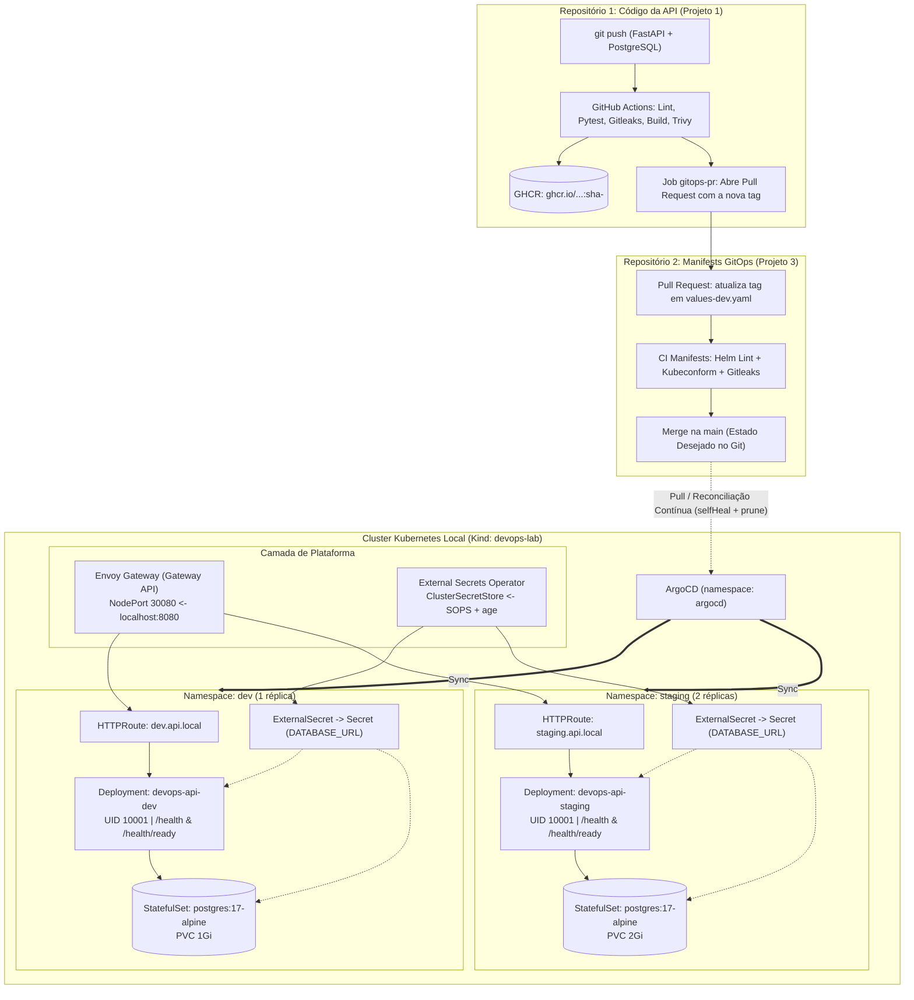

# Diagrama de Arquitetura — GitOps com Kubernetes e ArgoCD

## 1. Fluxo Ponta a Ponta (2 Repositórios: Código vs Manifests)

## 2. Componentes por Camada

| Camada | Componente | Papel na Arquitetura |
|---|---|---|
| **Cluster Local** | `kind` (`devops-lab`) | Cluster Kubernetes em Docker com `extraPortMappings` (`127.0.0.1:8080 -> 30080`) |
| **GitOps Controller** | **ArgoCD** | Reconciliação contínua (modelo Pull) com `automated.selfHeal: true` e `prune: true` |
| **Roteamento (Gateway API)** | **Envoy Gateway** (`gateway.networking.k8s.io/v1`) | Substitui o antigo Ingress NGINX; expõe `Gateway` compartilhado e `HTTPRoute` por ambiente |
| **Gestão de Segredos** | **SOPS (`age`) + External Secrets Operator** | Semente criptografada no Git com SOPS; `ExternalSecret` gera `DATABASE_URL` em `dev` e `staging` |
| **Empacotamento** | **Helm Chart próprio (`devops-api`)** | Empacota a API do Projeto 1 + PostgreSQL 17 StatefulSet (zero charts da Bitnami) |
| **Ambientes** | `values-dev.yaml` & `values-staging.yaml` | Isolamento de recursos, réplicas e hostnames entre `dev` e `staging` |
| **Progressive Delivery (Opcional)** | **Argo Rollouts** | Canary deployment opcional (`rollout.enabled: true`) com divisão de tráfego na `HTTPRoute` |
